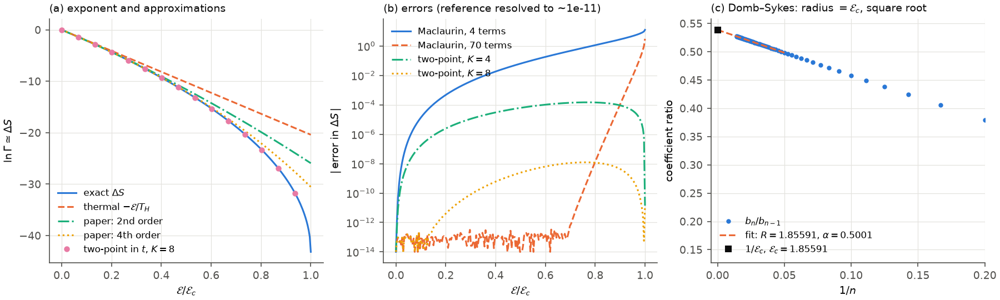

# blackholes

Reproducible, independently verified numerics for

> M. A. Aguirre Cortés, M. Bravo-Gaete, J. A. Méndez-Zavaleta, E. Rojas Marcial,
> *Horizon kinematics and the fine structure induced by finite-energy Hawking radiation*,
> [arXiv:2611.23376](https://arxiv.org/abs/2611.23376) (2026).

The goal is a small, well-tested library that regenerates every figure and quoted
number of the paper, exposes the series machinery (Lagrange–Bürmann and Puiseux
inversion of the horizon condition) to arbitrary order, and extends the analysis
where the paper stops (convergence radii, resummed endpoint behaviour, and later
greybody factors and evaporation trajectories).

This is an independent companion project; it is not affiliated with the authors.

## Reproduce the paper

```bash
uv sync
uv run python scripts/reproduce_paper.py      # ~10 s; writes outputs/figures/*.{pdf,png}
```

Every number printed in the paper is recomputed independently:

| quantity | paper | reproduced |
|---|---|---|
| Fig. 2: neutral E_c = M_i − M_e | 1.856 | 1.85591265 |
| Fig. 6: ΔS(E_c) | −43.209 | −43.20879253 |
| Fig. 6: relative error of 2nd / 4th-order truncation at E_c | 40% / 29% | 40.004% / 29.348% |
| Fig. 4: E_c (neutral, linear ½, linear ¾, exponential, fractional) | 3.9347, 4.0606, 4.0930, 3.9787, 4.0323 | 3.93468533, 4.06056292, 4.09298258, 3.97870019, 4.03229894 |
| Fig. 4: delayed inner recovery E_s | 3.6477 | 3.64774509 |
| Fig. 3: fractional-loss exponent p | 0.1063 | 0.10633597 |

The test suite also checks the closed forms of Eqs. (2.21), (2.22), (3.5), (4.17)/(E.6)–(E.7),
(4.22)–(4.23), (4.37)–(4.39), (4.46)–(4.47), (5.2), (5.5), (A.5), (C.6), (C.8)–(C.10) and
(D.12)–(D.17), the first law (4.8), the Smarr relation (4.9) and the field equations of App. D.1.

## Beyond the paper: convergence of the KPW series



For the neutral channel of Figs. 2 and 6:

1. **The emitted-energy series converges on the whole emission interval.** A Domb–Sykes fit of
   70 exact coefficients places its only nearby singularity at the outer coalescence,
   R = E_c (relative 10⁻⁶), with exponent α = 0.5000: a square-root branch point, as Eq. (3.17)
   predicts. Complex critical points of the mass function lie at |E| ≈ 275.
2. **This explains Fig. 6.** The coefficients decay like n^(−3/2) E_c^(−n), so an N-term
   truncation misses ΔS(E_c) by an amount that falls only as N^(−1/2): 40% (N=2), 29% (N=4),
   19% (N=10), still 7% at N=70.
3. **A uniform approximation.** In t = √(1 − E/E_c) the branch point unfolds. A polynomial in t
   matching the Lagrange–Bürmann data at E = 0 and the Puiseux data (App. C.4) at E_c converges
   geometrically, gaining roughly a factor 10 per term: 8 terms per end reproduce ΔS(E)
   to 10⁻⁸ on the entire interval, endpoint included.

## Layout

```
src/blackholes/
    series/        exact (SymPy) and float64 Lagrange–Bürmann / Puiseux inversion
    models/        the nonlinearly charged BTZ family (Sec. 4, App. D)
    emission/      charge profiles and horizon histories along emission channels
    analysis/      KPW series, Domb–Sykes convergence, two-point endpoint approximant
    paper/         exact figure configurations, quoted values, figure builders, style
scripts/           reproduce_paper.py
tests/             pytest + Hypothesis (beartype-instrumented at runtime)
```

## Quality gates

Every commit must pass, locally (pre-commit) and in CI:

- **ruff**: formatting and nearly every lint rule (`select = ["ALL"]`); each opt-out is justified in `pyproject.toml`.
- **mypy --strict**: plus extra error codes; `# type: ignore` requires an error code.
- **interrogate**: 100% docstring coverage, including private helpers.
- **pydoclint**: NumPy-style docstrings must match signatures, returns and raises.
- **codespell**: spelling in code and prose.
- **pytest**: warnings are errors, test order randomized, doctests run, 95% branch coverage minimum.
- **beartype**: every function in the package is type-checked at runtime during tests.
- **Hypothesis**: property-based tests for mathematical invariants (e.g. inversion round trips).

Physics conventions: ħ = 1; code symbols follow the paper (`M`, `Q`, `E`, `T_H`);
functions implementing an equation cite it as "Eq. (x.y)" in the docstring.
