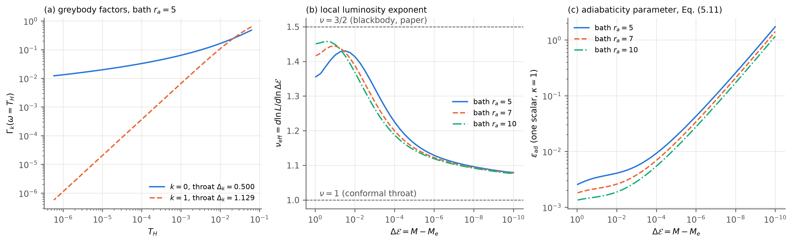
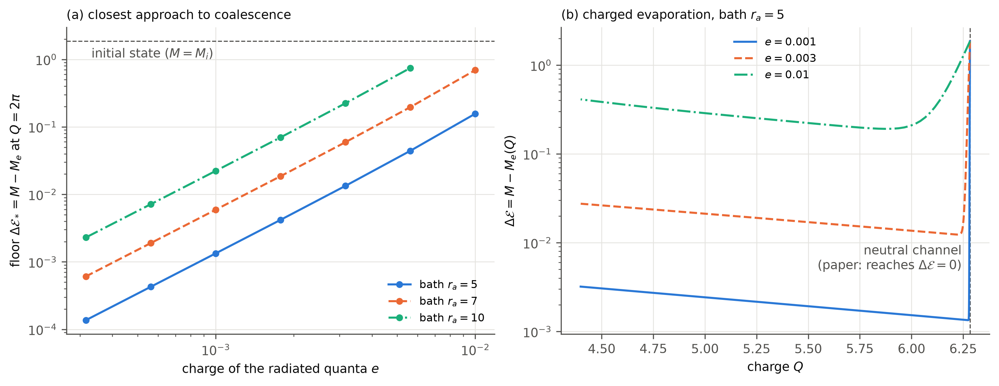

# blackholes

Reproducible, independently verified numerics for

> M. A. Aguirre Cortés, M. Bravo-Gaete, J. A. Méndez-Zavaleta, E. Rojas Marcial,
> *Horizon kinematics and the fine structure induced by finite-energy Hawking radiation*,
> [arXiv:2611.23376](https://arxiv.org/abs/2611.23376) (2026).

The goal is a small, well-tested library that regenerates every figure and quoted
number of the paper, exposes the series machinery (Lagrange–Bürmann and Puiseux
inversion of the horizon condition) to arbitrary order, and extends the analysis
where the paper stops (convergence radii, resummed endpoint behaviour, greybody
factors and the near-extremal emission rate).

This is an independent companion project; it is not affiliated with the authors.

## Findings at a glance

| # | Finding | Status |
|---|---|---|
| 1 | Every number printed in the paper (11 values) and ~30 closed-form equations are reproduced independently. No errors found. | verified |
| 2 | The paper's energy series for the tunneling exponent converges all the way to the outer coalescence E_c, with a square-root singularity there. | new, numerical (Domb–Sykes, 70 terms) |
| 3 | This explains Fig. 6: the error at E_c falls only like N^(−1/2), giving exactly the quoted 40% and 29%. | new, verified |
| 4 | In t = √(1 − E/E_c) a two-point polynomial converges geometrically: 8 terms per end give ΔS to 10⁻⁸ on the whole interval. | new, verified |
| 5 | Near zero temperature the conformally coupled scalar's s-wave sits exactly at the AdS₂ stability (BF) bound, for *every* static extremal horizon of the form (2.1). | new, analytic |
| 6 | Consequently the luminosity near coalescence scales as L ∝ T² (ν → 1), not the blackbody L ∝ T³ (ν = 3/2) assumed in Sec. 5. | new, analytic + numerical (bath-independent) |
| 7 | With ν < 3/2 the adiabaticity parameter of Eq. (5.11) grows without bound as the black hole cools: the late approach to extremality is not adiabatic. | new; depends on the radiated field and the bath model (see below) |
| 8 | The extremal throat carries an electric field whose effective AdS₂ charge is exactly 2π e r_e/(κQ) for every member of the family. A massless, conformally coupled charged scalar therefore breaks the charged BF bound for *any* e ≠ 0: the throat pair-produces charge even at T = 0. | new, analytic |
| 9 | With charged quanta in the spectrum the hole never reaches the outer coalescence. Thermal cooling and superradiant discharge balance on a floor ΔE* ∝ e², and the hole then discharges along that floor instead of following any of the paper's prescribed channels. | new, numerical; floor values depend on the bath, its existence does not |

## Reproduce the paper

```bash
uv sync
uv run python scripts/reproduce_paper.py      # ~10 s; writes outputs/figures/*.{pdf,png}
```

Every number printed in the paper is recomputed independently:

| quantity | paper | reproduced |
|---|---|---|
| Fig. 2: neutral E_c = M_i − M_e | 1.856 | 1.85591265 |
| Fig. 6: ΔS(E_c) | −43.209 | −43.20879253 |
| Fig. 6: relative error of 2nd / 4th-order truncation at E_c | 40% / 29% | 40.004% / 29.348% |
| Fig. 4: E_c (neutral, linear ½, linear ¾, exponential, fractional) | 3.9347, 4.0606, 4.0930, 3.9787, 4.0323 | 3.93468533, 4.06056292, 4.09298258, 3.97870019, 4.03229894 |
| Fig. 4: delayed inner recovery E_s | 3.6477 | 3.64774509 |
| Fig. 3: fractional-loss exponent p | 0.1063 | 0.10633597 |

The test suite also checks the closed forms of Eqs. (2.21), (2.22), (3.5), (4.17)/(E.6)–(E.7),
(4.22)–(4.23), (4.37)–(4.39), (4.46)–(4.47), (5.2), (5.5), (A.5), (C.6), (C.8)–(C.10) and
(D.12)–(D.17), the first law (4.8), the Smarr relation (4.9) and the field equations of App. D.1.

## Beyond the paper: convergence of the KPW series


For the neutral channel of Figs. 2 and 6:

1. **The emitted-energy series converges on the whole emission interval.** A Domb–Sykes fit of
   70 exact coefficients places its only nearby singularity at the outer coalescence,
   R = E_c (relative 10⁻⁶), with exponent α = 0.5000: a square-root branch point, as Eq. (3.17)
   predicts. Complex critical points of the mass function lie at |E| ≈ 275.
2. **This explains Fig. 6.** The coefficients decay like n^(−3/2) E_c^(−n), so an N-term
   truncation misses ΔS(E_c) by an amount that falls only as N^(−1/2): 40% (N=2), 29% (N=4),
   19% (N=10), still 7% at N=70.
3. **A uniform approximation.** In t = √(1 − E/E_c) the branch point unfolds. A polynomial in t
   matching the Lagrange–Bürmann data at E = 0 and the Puiseux data (App. C.4) at E_c converges
   geometrically, gaining roughly a factor 10 per term: 8 terms per end reproduce ΔS(E)
   to 10⁻⁸ on the entire interval, endpoint included.

## Beyond the paper: Hawking emission near extremality



**Setup and assumptions (read these first).** One massless, conformally coupled real scalar
(ξ = 1/8) is radiated during neutral emission along the Fig. 2 path. The radiation is absorbed by a
bath at radius r_a ∈ {5, 7, 10}. There is no canonical "infinity" for this family: its electric field
grows like ln r, so the bath placement is a modelling choice, and we report only what does *not*
depend on it. Units κ = ℓ = 1; the adiabaticity parameter scales with κ times the number of radiated
fields. Modes with |k| ≥ 2 cannot propagate to these baths at low frequency; their contribution is
suppressed as T^2.5 near extremality anyway. A minimally coupled scalar is confined by its potential
(V ∝ r²) and needs a different bath model, so it is not computed.

**Analytic result.** At the outer coalescence the horizon is an AdS₂ × S¹ throat with
L₂² = 2/f''(r_e). A mode e^(ikφ) has dimension Δ_k = ½ + √(¼ − 2ξ + 2k²/(f''(r_e) r_e²)), using
R(r_e) = −f''(r_e). For ξ = 1/8 the s-wave gives Δ₀ = ½, exactly at the Breitenlohner–Freedman
bound, independent of the couplings. Greybody factors then scale as Γ_k ∝ T^(2Δ_k − 1), so
L ∝ T^(2Δ₀ + 1) = T² up to logarithms. With T ∝ ΔE^(1/2) this is ν = 1. The paper's blackbody
estimate ν = 3/2 corresponds to Δ₀ = 1 (minimal coupling).

**Numerical confirmation** (41 states down to ΔE = 10⁻¹⁰, 86 s on an RTX 3090):

- k = 1 greybody exponent: measured 1.257146 against the predicted 1.257150, for all three bath radii.
- Local exponent ν_eff = d ln L / d ln ΔE: about 1.35–1.45 far from extremality (close to the paper's
  3/2), then falling to 1.08 at ΔE = 10⁻¹⁰ and approaching 1, with the bath radii collapsing onto a
  single curve.
- Adiabaticity parameter ε_ad (Eq. (5.11), one scalar, κ = 1): grows from 3×10⁻³ to ≈ 1.7. Because
  ν < 1 + n/2, it grows without bound for any κ and field content. The uniform adiabatic bound behind
  Eq. (5.14) therefore fails before T → 0, and the paper's "marginal" ν = 3/2 case does not apply to
  this field.
- Accuracy: doubling the integration steps changes L by 3×10⁻¹²; the JAX solver agrees with an
  independent adaptive SciPy solver to 10⁻⁶ (test suite).

Caveat: deep in this regime the quantum (Schwarzian) fluctuations of the AdS₂ throat also become
important (Brown et al., the paper's Ref. [24]). These results are the leading semiclassical
statement.

Reproduce (GPU optional; a few minutes on CPU):

```bash
uv sync --group cuda   # or plain `uv sync` for CPU
uv run python scripts/radiation_scan.py --points 41 --steps 12000 --min-log-gap -10
```

## Beyond the paper: charged emission and the actual evaporation path



The paper prescribes the charge profile Q(E) of each emission channel. If the radiated field is
charged, the profile is not free: the fluxes decide it. Here one massless, conformally coupled
*complex* scalar with quanta of charge ±e (units of Q) is radiated from the Fig. 2 initial state
(Q = 2π, M = M_i) into a bath at r_a. Same assumptions as above: test field, quasi-static
background, perfectly absorbing bath.

**Gauge coupling.** The field couples to A_t = −Φ of Eq. (4.7). Only Φ(r) − Φ(r_a) enters, and
the horizon frequency ω̃ = ω − e[Φ(r_+) − Φ(r_a)] is gauge invariant. For 0 < ω < eΦ_rel the
greybody factor is negative (superradiance), and its product with the Bose factor stays finite
as T → 0.

**Bookkeeping (gauge invariant).** With F_Q the charge flux and F_H = Σ∫ω̃ Γ n the horizon-energy
flux, the first law (4.8) gives T dS/dt = −F_H and dQ/dt = −F_Q. Using ∂_r m(r_e) = 0, the
paper's distance from coalescence ΔE = M − M_e(Q) evolves as

    dΔE/dt = −F_H − [Φ(r_+) − Φ(r_e)] F_Q.

Superradiant quanta have ω̃ < 0, so they raise S and push ΔE *up*.

**Analytic result.** Near r_e the field strength is E_e = −Φ'(r_e). Using m'(r_e) = 0 the
effective AdS₂ charge simplifies to e E_e L₂² = e r_e/(κ q) = 2π e r_e/(κ Q) for every member of
the family. The charged throat dimension becomes Δ = ½ + √(¼ − 2ξ + 2k²/(f''r_e²) − (2π e r_e/κQ)²).
For ξ = 1/8 the s-wave is already at the BF bound, so any e ≠ 0 makes Δ complex, and the throat
pair-produces charge at zero temperature (a Schwinger effect). A minimally coupled field would
need e > κQ/(4π r_e).

**Numerical results** (r_a = 5, 7, 10):

- Near coalescence dΔE/dt tends to a finite *positive* constant as T → 0, so the hole is pushed
  away. Far from it thermal cooling wins, as in the neutral case.
- The two balance at a floor ΔE*. At Q = 2π it scales as ΔE* ∝ e^1.98 for small e on every bath.
  Examples: r_a = 5 gives ΔE* = 1.3×10⁻³ at e = 10⁻³ and 0.16 at e = 10⁻². For r_a = 10 and
  e = 10⁻² there is no floor at all: superradiance wins from the start.
- Time-evolved trajectories (implicit Radau in Killing time, 47–55 steps) drop onto the floor and
  then discharge along it while ΔE slowly grows. At the end (Q = 0.7 × 2π) they sit within 0.3%
  of the floor for e = 10⁻³ and 3×10⁻³. For e = 10⁻², where discharge is faster than relaxation,
  they lag it by 10%.
- Accuracy: the charged greybody factors agree with an independent adaptive SciPy solver to 10⁻⁶,
  including superradiant modes with |ω̃|/T ≈ 3000 (test suite). Doubling the steps changes the
  fluxes by ≲ 5×10⁻⁵.

**Numerical method.** Superradiant quanta oscillate |ω̃|/(4πT) times per e-fold near the horizon,
which makes fixed-step Runge–Kutta unstable deep in the throat. The solver therefore uses the
fourth-order Magnus integrator. The step matrix is traceless 2×2, so its exponential is evaluated
in closed form and the oscillation is integrated exactly at any frequency.

Caveats: the floor values depend on the bath radius, the field content and the (absent) mass of
the charged quanta. The existence of the floor for conformal coupling does not: it follows from
the throat analysis above, for massless quanta. A mass μ adds μ²L₂² under the square root, so
massive charged quanta (like minimally coupled ones) need e above a threshold before the throat
discharges at T = 0.

Reproduce (~15 min on one CPU):

```bash
uv run python scripts/discharge_scan.py --output-dir outputs/discharge
```

## Layout

```
src/blackholes/
    series/        exact (SymPy) and float64 Lagrange–Bürmann / Puiseux inversion
    models/        the nonlinearly charged BTZ family (Sec. 4, App. D)
    emission/      charge profiles and horizon histories along emission channels
    analysis/      KPW series, Domb–Sykes convergence, two-point endpoint approximant
    radiation/     scalar greybody factors (JAX, charged or neutral), luminosity, charged
                   fluxes, discharge floor, AdS2 throat predictions
    paper/         exact figure configurations, quoted values, figure builders, style
scripts/           reproduce_paper.py, radiation_scan.py, discharge_scan.py
tests/             pytest + Hypothesis (beartype-instrumented at runtime)
```

## Quality gates

Every commit must pass, locally (pre-commit) and in CI:

- **ruff**: formatting and nearly every lint rule (`select = ["ALL"]`); each opt-out is justified in `pyproject.toml`.
- **mypy --strict**: plus extra error codes; `# type: ignore` requires an error code.
- **interrogate**: 100% docstring coverage, including private helpers.
- **pydoclint**: NumPy-style docstrings must match signatures, returns and raises.
- **codespell**: spelling in code and prose.
- **pytest**: warnings are errors, test order randomized, doctests run, 95% branch coverage minimum.
- **beartype**: every function in the package is type-checked at runtime during tests.
- **Hypothesis**: property-based tests for mathematical invariants (e.g. inversion round trips).

Physics conventions: ħ = 1; code symbols follow the paper (`M`, `Q`, `E`, `T_H`);
functions implementing an equation cite it as "Eq. (x.y)" in the docstring.
